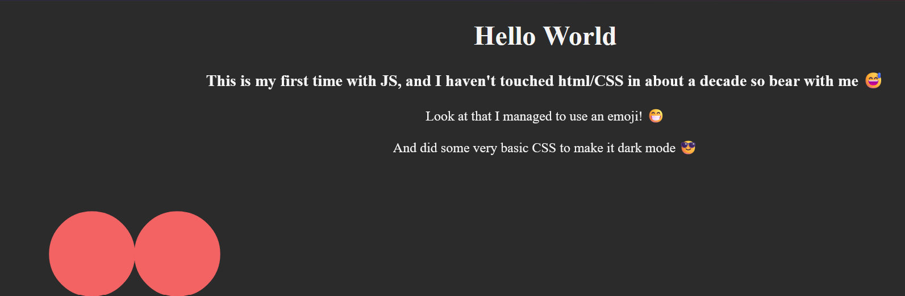
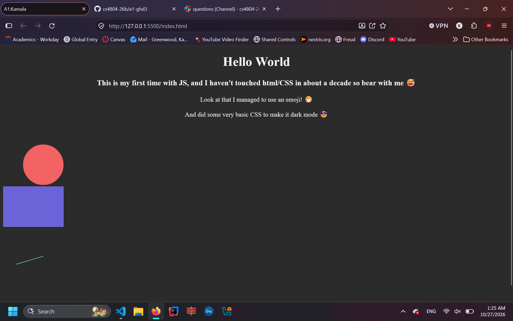

Assignment 1 - Hello World: GitHub and d3  
===
I used https://d3-graph-gallery.com/graph/shape.html as a source for learning how to make shapes appear
I appologise for how basic this is. I wish I had been able to do more and implement all my ideas. Sadly procrastination, confusion, and lack of experience led to this lackluster product.

Technical achievments:
1. I managed to make shapes appear
2. I messed around with some css such as making the background dark and changing the style of the text
3. If your reading this I managed to figure out github somewhat
4. I managed to locally host
5. I learned that each div has an ID which an svg is attached to but I can then later attach multiple SVGs to the same ID to make them overlap like this

Design achievments:
1. I implemented dark mode using a dark background and light text
2. I got images to appear in a read me? or I hope they did

I had come up with a design for a cat with simple shapes but it would have required more time and effort than I had set aside. I wanted to make a heart but I didn't end up figuring how to rotate a triangle to make the bottom. I never ended up figuring out how to move shapes on the screen to where I wanted them to be. I didn't manage to animate or make anything intresting. I wanted to make a convex hull but couldn't even get that to work. Overall my "work" is lackluster. Maybe I should have had AI help me, but at that point why am I even doing anything when I am just relying on AI to do it for me.

My heart mid progress before I gave up

My dismal final product

