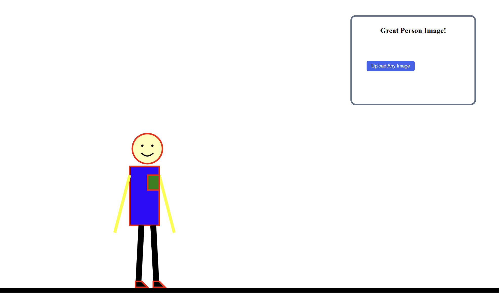
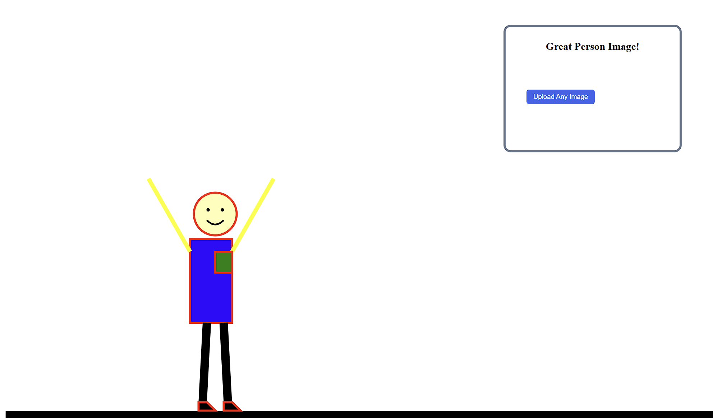
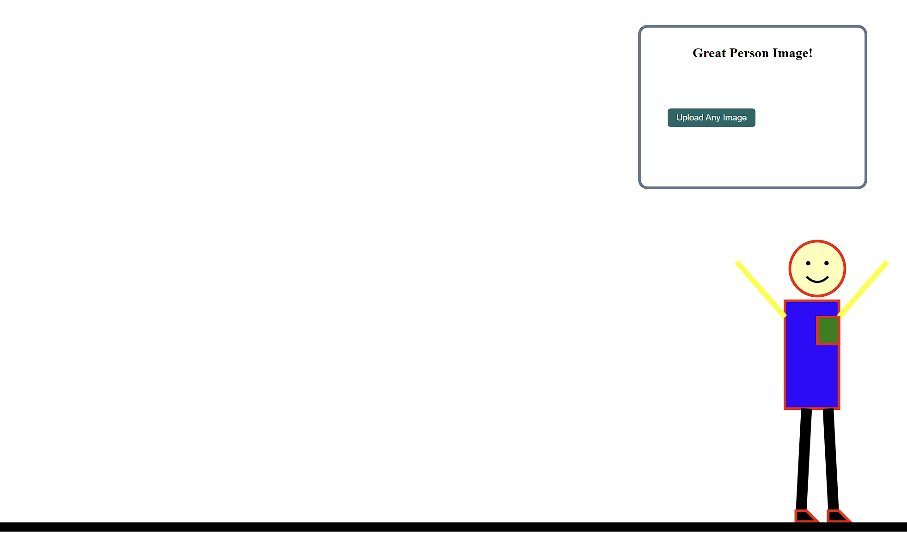

# Homework 1

# Link:
https://wpi-simontong.github.io/a1-ghd3/

At the starting position , the person's arms point down. They repeatedly raise and lower to wave toward the image area on the right, as shown in . Use the upload button to choose an image from your computer. You can also move the person horizontally with 'A' or the 'left arrow', and 'D' or the 'right arrow';  shows an example.

## Technical Achievement

The upload button opens a hidden file input configured to accept image files. When a file is selected, the code checks that a file was provided and that its MIME type starts with `image/`. It creates a temporary object URL for a valid image and sets that URL as the `href` of an SVG `<image>`, which is displayed inside the framed image area while preserving its aspect ratio. The placeholder text and upload button are hidden after a successful upload.

The person can be moved with the **A**/**left arrow** and **D**/**right arrow** keys. Each key press moves the person's SVG group by 20 pixels horizontally. The code clamps the horizontal offset to keep the figure within the SVG board, then updates the group's `translate` transform so all of its parts move together.

## Design Achievement

The character is built from SVG shapes grouped together: a rectangle for the body, circles for the head and eyes, lines for the arms and legs, polygons for the pocket and feet, and a curved path for the mouth. The group makes it possible to move the complete character as one unit. D3 transitions animate the arms by changing each line's endpoint between raised and lowered positions. Each motion lasts 800 milliseconds, uses a cubic ease-in-out, and repeats when it ends, creating a continuous wave toward the uploaded image.