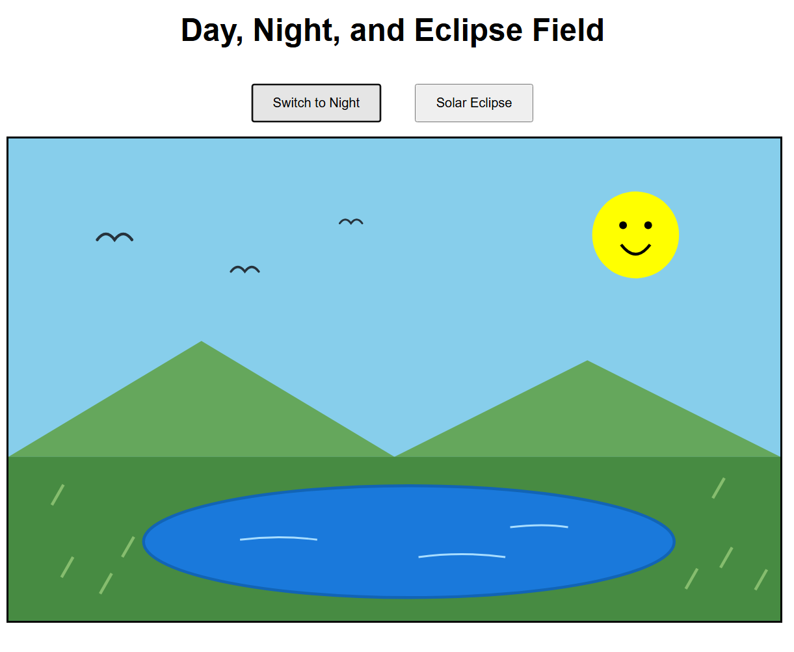
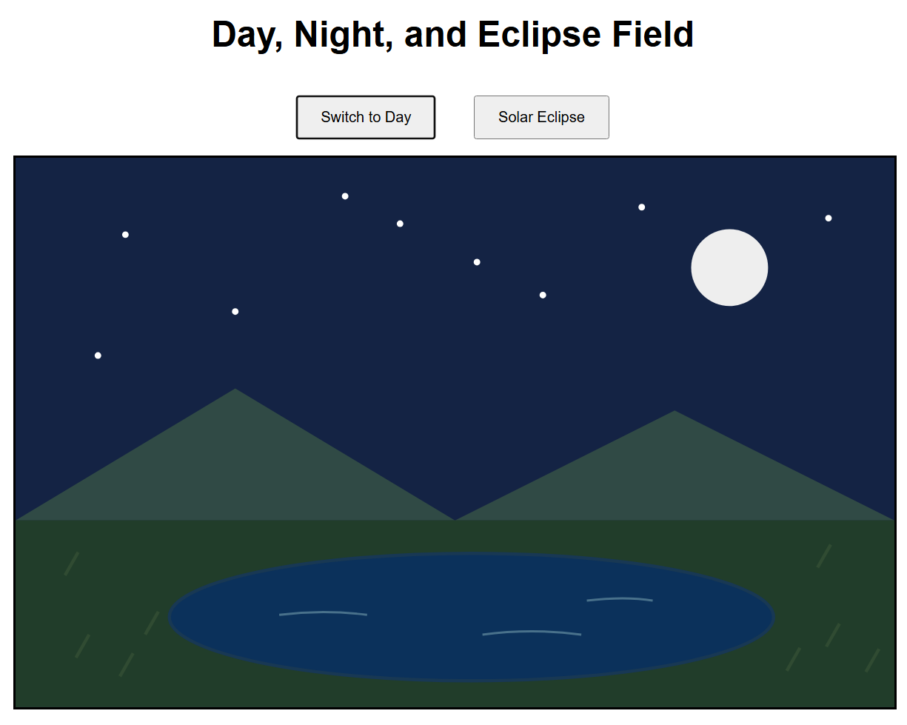
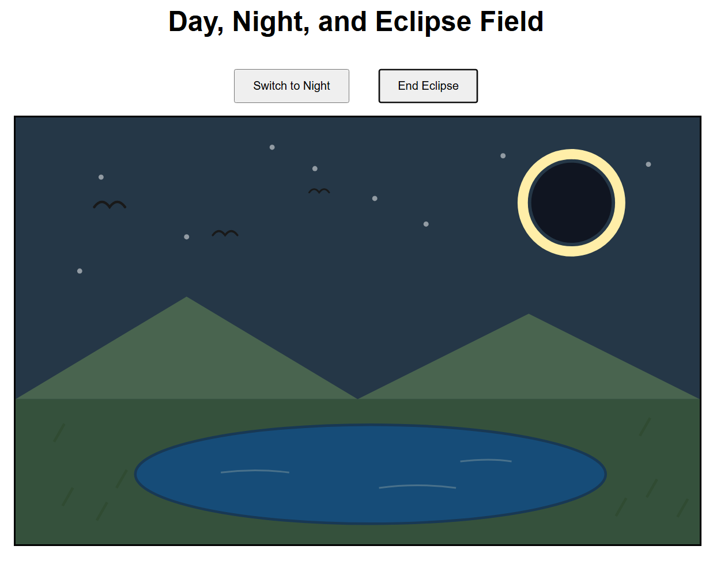

# Assignment 1 - Day and Night Field

## Project Description
My project is centered around a beautiful mountain field with a lake. I added functionality to switch between day and night, as well as a functionality to enact a solar eclipse. The condition changes cause the colors of the scene to shift as well through animated transitions. 

## GitHub Page Link
[My Visualization](https://sskar04.github.io/a1-ghd3/)
## Screenshots

### Daytime

### Nighttime

### Eclipse

## Technical Achievements

### Technical Achievement 1 - Shapes
I used additional shapes with D3, including an ellipse for the lake and paths for the birds, water ripples, and the smile on the sun. 

### Technical Achievement 2 - Transitions
My changeScene() function updates almost every element in the scene using D3 transitions, affecting color and opacity mainly. I also added transitions in between the three different scenes for smooth switching between scenes.

### Technical Achievement 3 - User Interactions
I added buttons to allow users to switch between the different scenes and trigger animations. I also added tooltips for different fixtures in the scene, like the sun, the moon, the eclipse, and the lake. This required some handling as I had to figure out how to, for example, not make the moon tooltip show during the day time scene and vice versa. 

## Design Achievements

### Design Achievement 1
I wanted my visualization to be lively and happy. I chose bright colors for the daytime mountain scene to reflect a beautiful summer day hiking. I also made the scene responsive to the different conditions you enact, changing colors to reflect the night or the solar eclipse.

### Design Achievement 2
I went beyond the required shapes by adding extra details, including birds, water ripples, a lake, and a smiling sun. I also included a seperate solar eclipse mode in addition to the day and night cycle, allowing the scene to change between 3 distinct conditions and color palettes. I also had to deal with challenges with layering and opacity. I ended up mapping the opacity of the sun, moon, eclipse moon, and corona to the button that is selected.

## Sources and References

- D3 Selections:
  https://d3js.org/d3-selection
  Used to learn how to create SVG elements.

- D3 Event Handling:
  https://d3js.org/d3-selection/events
  Used for click events and interactions.

- D3 Transitions:
  https://d3js.org/d3-transition
  Used for animated changes between scenes.

- MDN SVG Basic Shapes:
  https://developer.mozilla.org/en-US/docs/Web/SVG/Tutorials/SVG_from_scratch/Basic_shapes
  Used for SVG shape attributes.

- MDN SVG Paths:
  https://developer.mozilla.org/en-US/docs/Web/SVG/Tutorials/SVG_from_scratch/Paths
  Used for curves and paths.

- ChatGPT (OpenAI):
  Assisted with JavaScript/D3 implementation,
  debugging, scene transitions, and SVG shapes.
