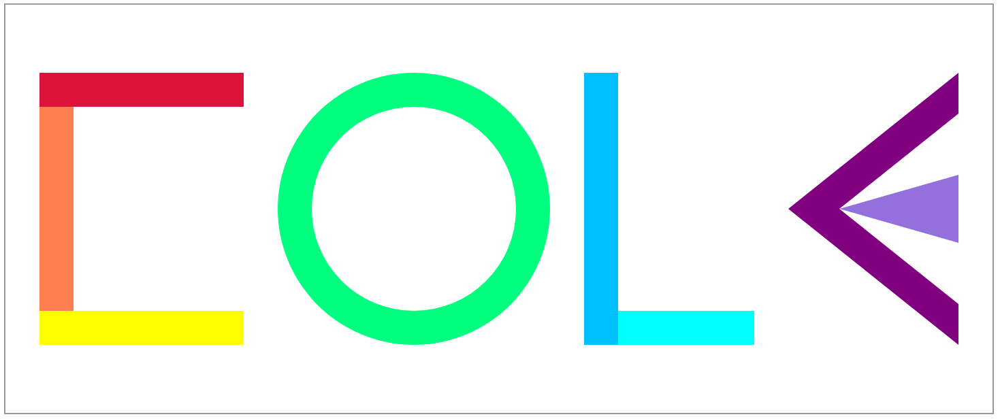

Technical Achievement Description
---
I used D3.js to generate an SVG graphic spelling out my name using rectangles, circles, lines, and paths. I also implemented animations for each type of graphic, so that each letter would glide downwards by 50 px. Additionally, I made sure to stagger the animations so they don't all occur at once. I also used D3's line generator to create custom polygonal paths from coordinate data. This project strengthened my understanding of SVG graphics, and different functionalities available via the D3.js library. 

Design Achievement Description
---
I designed a colorful geographic representation of my name (in all caps), using a unique arrangement of shapes for each letter. The C is formed using 3 different colored rectangles. The O is formed using 2 concentric circles. The L is formed using 2 different colored perpendicular lines. The E is formed with layered triangular paths that create an interesting angular design. I used contrasting colors to make it easier to distinguish between individual elements. I also chose the specific shades to give it somewhat of a similar vibe to "Google". Lastly, I added a staging animation which moved the groups of shapes downward in quick succession to introduce some kind of visual interest.

